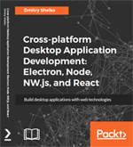

# Frontend Starter Templates

A collection of 15 frontend and full-stack starter templates covering a range of tools, patterns, and use cases. Each template is self-contained with its own `package.json`, README, and runnable source.

## Templates

### Full-stack / React

| Template | Stack |
|---|---|
| [React + Next.js](./react-nextjs) | Next.js 15, React 19, TypeScript 5, Ant.Design 5, MySQL |
| [React + Ant.Design + SSR](./react-antdesign-ssr) | React 18, Ant.Design 5, Redux Toolkit, Express, MySQL |
| [React + Redux + TypeScript](./react-redux-typescript) | React 16, Redux, TypeScript 4, Webpack 4, ESLint |
| [React + Redux](./react-redux) | React 16, Redux, Material UI v1, Webpack 4, Babel 6 |

### Build tooling

| Template | Stack |
|---|---|
| [Webpack + TypeScript + Jest](./webpack-typescript) | TypeScript 5, Webpack 5, Jest 29, ESLint |
| [Webpack + Babel](./webpack-babel) | Webpack 4, Babel 7, ESLint, dual modern/legacy bundles |
| [RequireJS + Babel](./babel-requirejs) | Babel 6, AMD modules, SASS |

### Testing

| Template | Stack |
|---|---|
| [E2E testing with Playwright](./playwright) | Playwright, page object model, fixtures, Chromium |
| [E2E testing with Puppeteer + Jest](./puppeteer-jest) | Jest, Puppeteer, Headless Chrome |
| [Karma + Jasmine](./jasmine-karma) | Webpack 3, Karma, Jasmine, headless Chrome |

### Styles

| Template | Stack |
|---|---|
| [SASS + PostCSS](./postcss) | node-sass, PostCSS, Autoprefixer |
| [Webpack + SASS](./webpack-sass) | Webpack 3, sass-loader, style-loader |

### Backend

| Template | Stack |
|---|---|
| [Express REST API](./express) | Express 4, Jasmine, apidoc |

### Webpack loaders

| Template | Stack |
|---|---|
| [Webpack + Images](./webpack-images) | Webpack 3, file-loader, ImageMin |
| [Webpack + SQIP](./webpack-sqip) | Webpack 4, React 16, SVG image placeholders |

---

**Cross-platform Desktop Application Development: Electron, Node, NW.js, and React**

Four progressive tutorials: a file explorer with NW.js and Node.js, a chat app with Electron and React, a screen capturer with NW.js/React/Redux and Material UI, and an RSS aggregator with Electron, React, Redux, and TypeScript.
