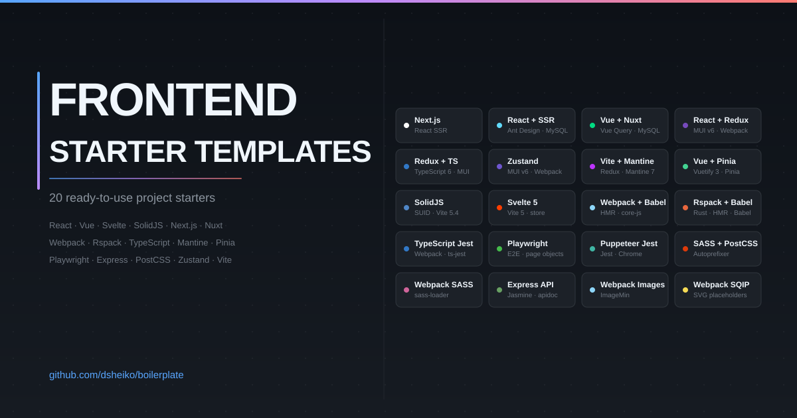

# Frontend Starter Templates

A collection of 20 frontend and full-stack starter templates covering a range of tools, patterns, and use cases. Each template is self-contained with its own `package.json`, README, and runnable source.

## Templates

### Full-stack apps

| Template | Stack |
|---|---|
| [React + Next.js](./react-nextjs) | Next.js 16, React 19, TypeScript 5, Ant Design 5, React Query 5, MySQL |
| [React + Ant.Design + SSR](./react-antdesign-ssr) | React 18, Ant.Design 5, Redux Toolkit 2, Express, MySQL |
| [Vue + Nuxt](./vue-nuxt) | Nuxt 3, Vue 3, TypeScript 5, Ant Design Vue 4, Vue Query 5, MySQL |

### State management

| Template | Stack |
|---|---|
| [React + Redux](./react-redux) | React 19, Redux Toolkit 2, MUI v6, Webpack 5, Babel 7 |
| [React + Redux + TypeScript](./react-redux-typescript) | React 19, Redux Toolkit 2, TypeScript 6, MUI 9, Webpack 5 |
| [React + Zustand](./react-zustand) | React 19, Zustand 5, MUI v6, Webpack 5, Babel 7 |
| [React + Vite + Mantine](./react-vite-mantine) | React 19, Redux Toolkit 2, Mantine 7, Vite 5 |
| [Vue + Pinia](./vue-pinia) | Vue 3, Pinia 2, Vuetify 3, Webpack 5 |

### Alternative frameworks

| Template | Stack |
|---|---|
| [SolidJS + Store](./solidjs-store) | SolidJS 1.9, SUID Material 0.17, Vite 5.4 |
| [Svelte + Store](./svelte-store) | Svelte 5, Vite 5.4 |

### Build tooling

| Template | Stack |
|---|---|
| [Webpack + Babel](./webpack-babel) | Webpack 5, Babel 7, core-js, HMR, dynamic imports |
| [Webpack + TypeScript + Jest](./webpack-typescript) | TypeScript 5, Webpack 5, Jest 29, ESLint |
| [Rspack + Babel](./rspack-babel) | Rspack, Babel 7, core-js, HMR |

### Testing

| Template | Stack |
|---|---|
| [E2E testing with Playwright](./playwright) | Playwright, page object model, fixtures, Chromium |
| [E2E testing with Puppeteer + Jest](./puppeteer-jest) | Jest 29, Puppeteer, headless Chrome |

### Styles

| Template | Stack |
|---|---|
| [SASS + PostCSS](./postcss) | node-sass, PostCSS, Autoprefixer |
| [Webpack + SASS](./webpack-sass) | Webpack 5, sass-loader, style-loader |

### Backend

| Template | Stack |
|---|---|
| [Express REST API](./express) | Express 4, Jasmine, apidoc |

### Webpack loaders

| Template | Stack |
|---|---|
| [Webpack + Images](./webpack-images) | Webpack 5, file-loader, ImageMin |
| [Webpack + SQIP](./webpack-sqip) | Webpack 4, React 16, SVG image placeholders |

---

**Cross-platform Desktop Application Development: Electron, Node, NW.js, and React**

Four progressive tutorials: a file explorer with NW.js and Node.js, a chat app with Electron and React, a screen capturer with NW.js/React/Redux and Material UI, and an RSS aggregator with Electron, React, Redux, and TypeScript.
