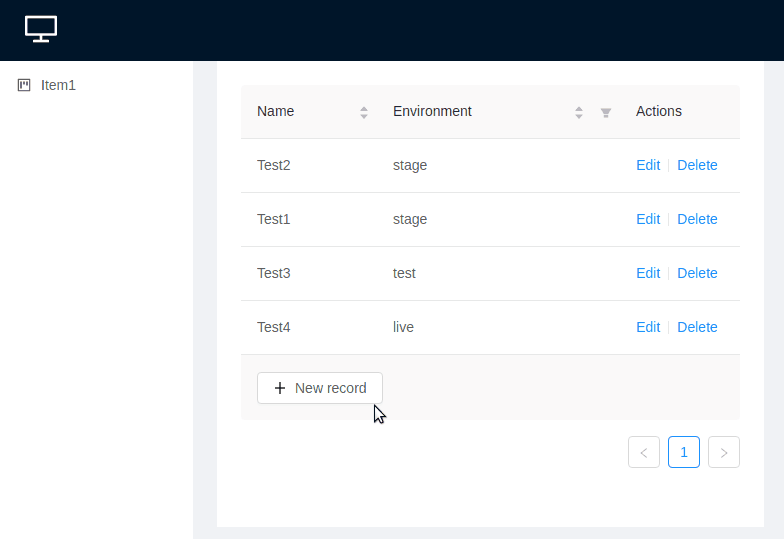

# Starter template: React + Ant.Design + SSR

Data table UI with sorting, filtering, and pagination. React 18 + Ant.Design 5 on the frontend, Express + MySQL on the backend, with full server-side rendering via `@loadable/component`.



## Prerequisites

- Node.js >= 16
- MySQL 8+

## Stack

| Tool | Purpose |
|---|---|
| React 18 | UI library |
| Ant.Design 5 | Component library (Table, Form, etc.) |
| Redux Toolkit | State management |
| React Router 6 | Client and server routing |
| Express 4 | HTTP server and SSR renderer |
| @loadable/component | Code splitting with SSR support |
| Webpack 5 | Bundles frontend and backend |
| MySQL | Data storage |
| db-migrate | Schema migrations |

## Setup

1. Install dependencies:
```bash
npm install
```

2. Configure the database:
```bash
cp .env.dist .env
```
Edit `.env` with your MySQL credentials.

3. Create the database:
```sql
CREATE DATABASE react_antd;
```

4. Run migrations, build, and start:
```bash
npm run migrate:up
npm run build
npm start
```

The server listens at `http://127.0.0.1:9100/`.

## Development mode

```bash
npm run watch
```

Starts nodemon for the server and Webpack in watch mode for both frontend and backend bundles simultaneously.

## Commands

| Command | Description |
|---|---|
| `npm run build` | Build backend and frontend bundles |
| `npm run watch` | Dev mode: server + both bundles in watch mode |
| `npm start` | Start the production server |
| `npm run migrate:up` | Apply pending migrations |
| `npm run migrate:down` | Rollback the last migration |

## Project structure

```
backend/
  Router/
    Render/    SSR entry point (renders React to HTML string)
    api/       REST API route handlers
frontend/
  src/
    Components/  UI components
    Containers/  Redux-connected containers
    Actions/     Redux actions
    Reducers/    Redux reducers
migrations/    db-migrate SQL migration files
index.js       Express server entry point
database.json  db-migrate connection config (reads from .env)
```

## Code examples

| File | Pattern |
|---|---|
| `frontend/src/Components/Head/Head.jsx` | Redux from client-side |
| `backend/Router/Render/index.jsx` | Redux from server-side (SSR) |
| `frontend/src/Containers/App.jsx` | Code splitting with prefetch, shared routes |
